<div align="center">


# Nurse Simulator — Frontend

[](https://angular.dev/)
[](https://www.typescriptlang.org/)
[](https://rxjs.dev/)
[](https://vitest.dev/)
[](.prettierrc)
[](https://nodejs.org/)
[-E2001A?style=for-the-badge)](https://www.stucom.com/)
[](#)

<p align="center">
  <strong>Aplicación Web en Angular &amp; TypeScript para la Gestión y Visualización del Personal de Enfermería</strong><br>
  M0616 — Proyecto Intermodular | 2º Desarrollo de Aplicaciones Web (DAW)
</p>

[Documentación Completa (ES)](docs/general/DOCUMENTACION_ES.md) • [Full Documentation (EN)](docs/general/DOCUMENTATION_EN.md) • [Guía de Agentes (AGENTS.md)](AGENTS.md) • [API Backend (Nurse-Simulator)](https://github.com/Ignaciobrenas/Nurse-Simulator)

---

</div>

## 1. Sobre el Proyecto

**Nurse Simulator — Frontend** es la aplicación web cliente desarrollada con **Angular 22** y **TypeScript** para gestionar, autenticar y consultar visualmente el personal de enfermería del complejo hospitalario **Nurse Simulator**.

Este repositorio corresponde a la fase **PR06 (Introducció al Front-End)** del **Proyecto Intermodular (M0616)** en **2º DAW** (**STUCOM Pelai, Barcelona**, curso **2026/2027**). En esta entrega todas las vistas operan sobre datos simulados locales (`DEMO_ACCOUNTS` y `MOCK_NURSES`) sin conexión directa al backend, respetando los contratos de la API REST de [Nurse-Simulator](https://github.com/Ignaciobrenas/Nurse-Simulator) (como los campos `username` y `password` de `POST /nurse/login`) para facilitar la integración posterior.

### Equipo de Desarrollo y Roles (Grupo PR06)

| Miembro | Rol y Responsabilidades | Issues / PRs | GitHub |
|---|---|---|---|
| **Ignacio Breñas Muñoz** | **Project Manager & Tech Lead**<br>• Organización del tablero de proyecto, creación de ramas y revisión/integración de Pull Requests.<br>• Setup inicial de Angular 22, `<router-outlet />` base, tokens visuales (`--ns-*`) y logotipo hospitalario (`#1`).<br>• Desarrollo de la pantalla **Home** con selector de turnos y tarjetas de módulos (`#2`).<br>• Coordinación de la documentación técnica bilingüe y plantilla de PR (`#6`). | [#1](https://github.com/Ignaciobrenas/Nurse-Simulator-Frontend/issues/1), [#2](https://github.com/Ignaciobrenas/Nurse-Simulator-Frontend/issues/2), [#6](https://github.com/Ignaciobrenas/Nurse-Simulator-Frontend/issues/6)<br>(`PR #8`, `PR #9`) | [@Ignaciobrenas](https://github.com/Ignaciobrenas) |
| **Christopher Roger Tito** | **Desarrollador Frontend**<br>• Implementación de la pantalla **Login** con selector de roles, validación de campos, visibilidad de contraseña y bloqueo tras 3 intentos fallidos (`#3`).<br>• Pruebas unitarias en Vitest y evidencias gráficas de estados y responsive. | [#3](https://github.com/Ignaciobrenas/Nurse-Simulator-Frontend/issues/3)<br>(`PR #10`) | [@RogerTito455](https://github.com/RogerTito455) |
| **Gorka Ramirez** | **Desarrollador Frontend**<br>• Implementación de la pantalla **Nurse List** con listado completo de 10 enfermeros, filtros por turno y panel de inspección de perfil (`#4`).<br>• Modelo `Nurse`, dataset `MOCK_NURSES`, pruebas unitarias y capturas desktop/móvil. | [#4](https://github.com/Ignaciobrenas/Nurse-Simulator-Frontend/issues/4)<br>(`PR #11`) | [@gorkarmz](https://github.com/gorkarmz) |
| **Zehao Yin** | **Desarrollador Frontend**<br>• Implementación de la pantalla **Nurse Search** con búsqueda por nombre, consulta inicial de 3 resultados simulados (`'An'`), chips rápidos y detalles desplegables (`#5`).<br>• Pruebas unitarias en Vitest y capturas de todos los estados de búsqueda. | [#5](https://github.com/Ignaciobrenas/Nurse-Simulator-Frontend/issues/5)<br>(`PR #12`) | [@zyin-08](https://github.com/zyin-08) |

---

## 2. Objetivos y Requisitos de la Práctica (PR06)

Siguiendo las directrices de la práctica **PR06 (`pr06_daw_front_end.pdf`)**, cada pantalla de la aplicación cumple los requisitos técnicos de arquitectura moderna en Angular:

1. **Componentes Standalone con HTML Propio:** cada pantalla se encapsula en su propio directorio bajo `src/app/components/` con archivos `.ts`, `.html`, `.css` y `.spec.ts` dedicados.
2. **Navegación Bidireccional (`RouterLink`):** enrutamiento SPA fluido entre `Home <-> Login`, `Home <-> Nurse List` y `Home <-> Nurse Search` mediante `<router-outlet />` y `provideRouter(routes)`.
3. **Imágenes e Iconografía Hospitalaria:** integración del emblema `nurse-logo.png` e iconos SVG vectoriales integrados en cabeceras, tarjetas y controles.
4. **Interactividad mediante `(click)`:** botones, pestañas, chips y tarjetas interactivas que modifican señales reactivas (`signal` / `computed`) y actualizan la vista en tiempo real.
5. **Control de Flujo Moderno (`@if`, `@switch`, `@for`):** renderizado declarativo con seguimiento por clave (`track`) y bloques `@else` / `@else if` en todas las plantillas.

---

## 3. Identidad Visual, Diseño y Logotipo

La interfaz sigue una estética **clínica y hospitalaria limpia (*white & clinical green*)**, pensada para maximizar la legibilidad en entornos sanitarios mediante alto contraste sobre superficies blancas, bordes suaves y acentos en verde médico.

### 3.1. Logotipo Oficial (`public/nurse-logo.png`)

| Emblema Hospitalario | Significado y Uso en la Aplicación |
| :---: | :--- |
|  | **Composición visual:**<br>• **Escudo bipartito en verde clínico:** un escudo protector dividido verticalmente en dos tonalidades de verde (verde teal profundo a la izquierda y verde esmeralda brillante a la derecha) con un borde interior claro que simboliza seguridad y cuidado hospitalario.<br>• **Cruz médica blanca:** situada en el centro como símbolo universal de asistencia sanitaria y enfermería.<br>• **Trazo de pulso ECG:** una línea de electrocardiograma cruza horizontalmente la cruz, conectando ambos hemisferios del escudo para representar monitorización clínica activa y precisión en tiempo real.<br><br>**Presencia en el proyecto:** se muestra en la barra superior de las 4 pantallas (`Home`, `Login`, `Nurse List`, `Nurse Search`), en la tarjeta lateral de bienvenida de `Login` y como *favicon* de la aplicación en [`src/index.html`](src/index.html). |

### 3.2. Sistema de Diseño y Tokens CSS (`src/styles.css`)

Todos los componentes comparten variables CSS globales (`--ns-*`) definidas en [`src/styles.css`](src/styles.css) junto con la fuente `'Inter', system-ui, sans-serif`:

| Token CSS | Valor | Rol Visual en la Interfaz |
| :--- | :--- | :--- |
| `--ns-bg` | `#f4f8f5` | Fondo general de la aplicación con un matiz verde hospitalario muy tenue. |
| `--ns-surface` | `#ffffff` | Superficie principal de tarjetas, formularios y paneles de detalle. |
| `--ns-surface-muted` | `#edf5f0` | Contenedores secundarios, grupos de pestañas y bloques informativos. |
| `--ns-green` | `#0f766e` | Color primario de marca, acentos laterales y etiquetas clínicas destacadas. |
| `--ns-green-strong` / `--ns-green-hover` | `#047857` / `#065f46` | Botones principales de acción (`Switch Shift`, `Sign in`, `Cycle Filter`, `Search`) y estado `:hover`. |
| `--ns-green-soft` | `#e6f4ee` | Fondos de insignias activas (`Standard Duty`, `On Duty`), iconos de módulo y chips seleccionados. |
| `--ns-amber-bg` / `--ns-amber-text` | `#fef3c7` / `#92400e` | Alertas e insignias de guardia o turno nocturno (`On-Call Guard`, `Night`, bloqueo de `Login`). |
| `--ns-text` / `--ns-text-muted` | `#13261e` / `#4b6559` | Tipografía principal de alto contraste y textos descriptivos secundarios. |
| `--ns-border` / `--ns-border-hover` | `#d7e4dc` / `#7bb89b` | Contornos sutiles de tarjetas y resaltado interactivo al pasar el cursor o seleccionar un elemento. |
| `--ns-radius-lg` / `--ns-radius-md` | `14px` / `10px` | Geometría redondeada uniforme en tarjetas principales, inputs y botones. |

### 3.3. Patrones de Interfaz y Responsive Design

- **Cabecera unificada:** barra superior blanca con el escudo `nurse-logo.png`, el título `Nurse Simulator`, el subtítulo contextual del módulo y una acción directa de retorno a `/home` (o indicador `Nursing Station · Active` en la pantalla principal).
- **Acento clínico lateral:** las tarjetas principales de control (turno en `Home`, filtros en `Nurse List` y buscador en `Nurse Search`) incorporan una franja vertical verde en el borde izquierdo para jerarquizar el bloque interactivo principal.
- **Iconografía SVG inline:** iconos vectoriales ligeros (`stroke-width="1.8"` / `"2"`) sin librerías externas de fuentes, garantizando nitidez en cualquier resolución.
- **Adaptabilidad móvil (`390x844`):** rejillas CSS Grid que pasan de múltiples columnas en escritorio (2 columnas en `Login`, 3 en `Home` y `Nurse List`) a una columna apilada en móvil con botones accesibles.

---

## 4. Vistas de la Aplicación

### 4.1. Home (`/home`) — Portal Principal y Selector de Turno

- **Componente:** `Home` ([`home.component.html`](src/app/components/home/home.component.html) | [`home.component.ts`](src/app/components/home/home.component.ts))
- **Funcionalidad:** presenta el turno activo de planta (`Morning`, `Afternoon`, `Night`) con actualización dinámica del horario e insignia (`Standard Duty` / `On-Call Guard`) mediante `selectShift()` y `cycleShift()`, además de las 3 tarjetas de navegación hacia `/login`, `/nurse-list` y `/nurse-search`.
- **Directivas:** `@switch (activeShift())`, `@for (shift of shifts; track shift)` y `@for (screen of screens; track screen.route)`.

| Vista inicial (`Morning Shift`) | Cambio de turno (`(click)` -> `Night Shift`) | Diseño Responsive (Móvil) |
| :---: | :---: | :---: |
| 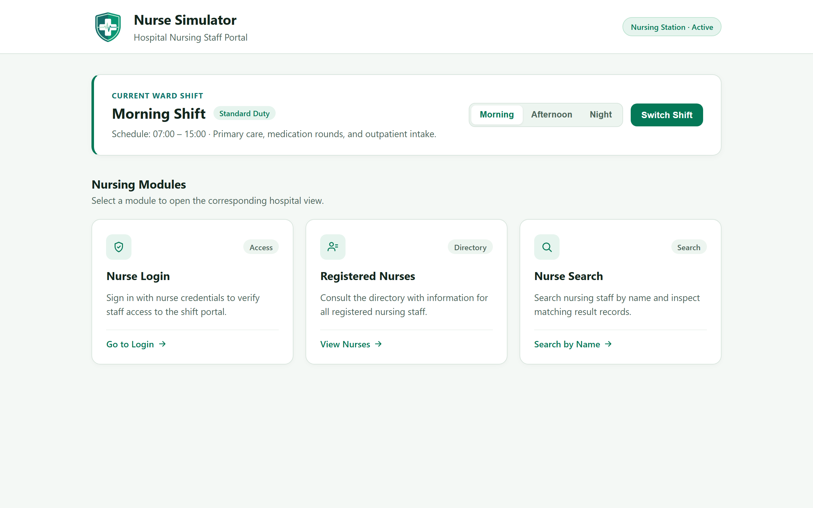 | 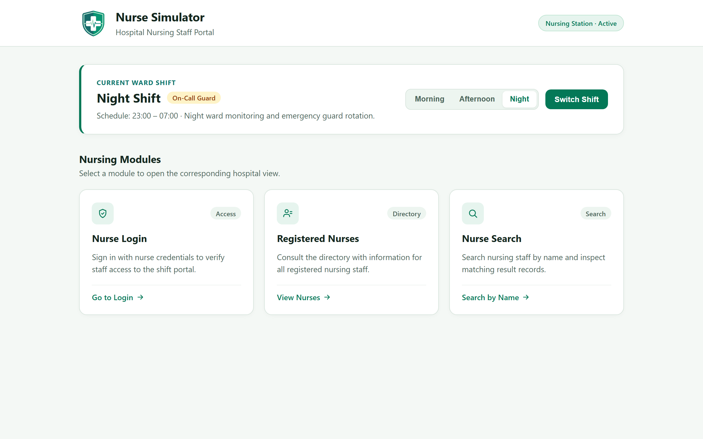 | 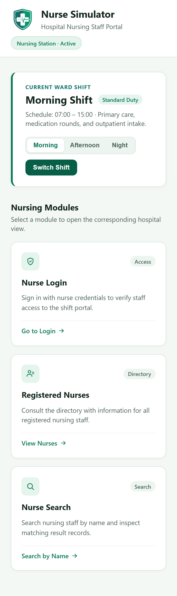 |

---

### 4.2. Login (`/login`) — Autenticación por Rol y Validación

- **Componente:** `Login` ([`login.component.html`](src/app/components/login/login.component.html) | [`login.component.ts`](src/app/components/login/login.component.ts))
- **Funcionalidad:** diseño en dos columnas con un panel informativo con degradado verde y la tarjeta de acceso. Permite alternar entre 3 roles (`Nurse`, `Head Nurse`, `Supervisor`), rellenar cuentas demo (`DEMO_ACCOUNTS`), mostrar/ocultar contraseña (`Show` / `Hide`), validar formato de credenciales, bloquear el formulario tras 3 intentos fallidos y mostrar el panel de bienvenida al iniciar sesión.
- **Directivas:** `@if` / `@else` (errores de campo, bloqueo, bienvenida), `@switch (selectedRole())` y `@for` (roles y lista de funcionalidades).

| Vista inicial (`Nurse`) | Bloqueo tras 3 intentos fallidos | Acceso concedido (`Supervisor`) | Diseño Responsive (Móvil) |
| :---: | :---: | :---: | :---: |
| 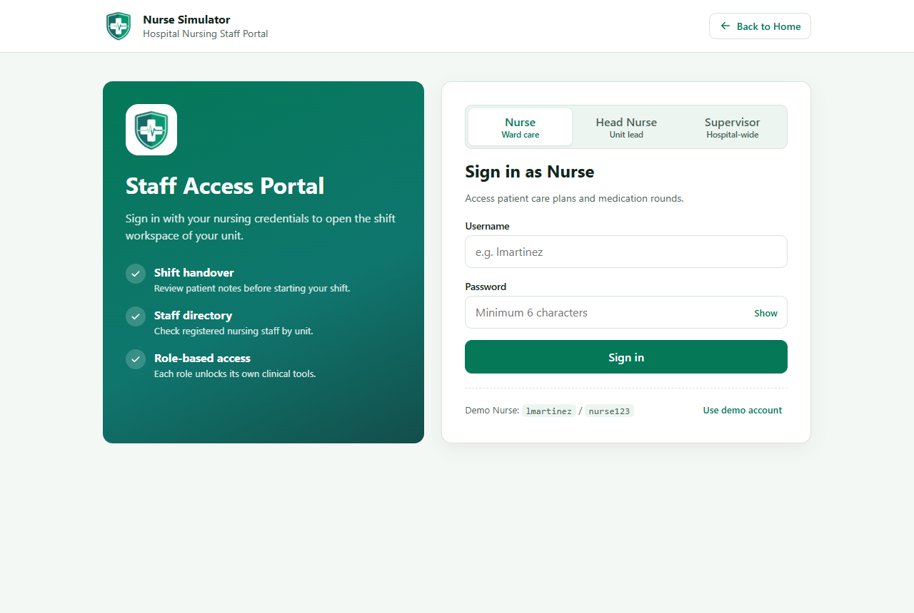 | 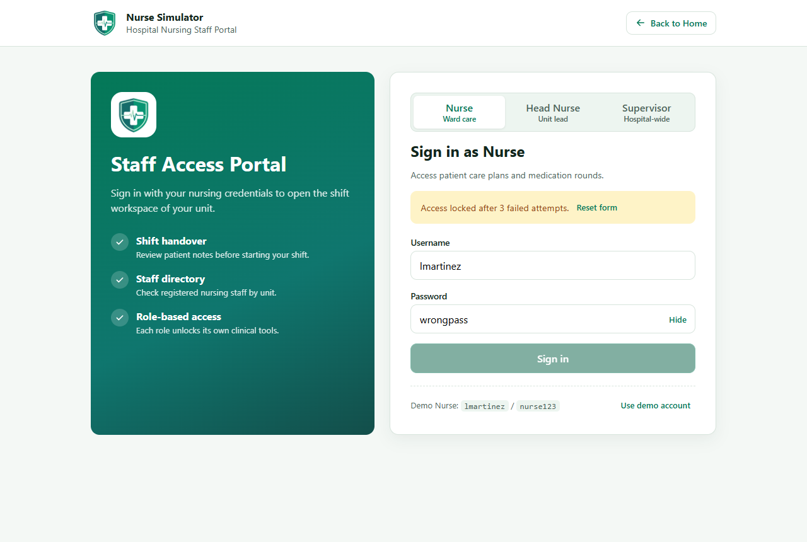 | 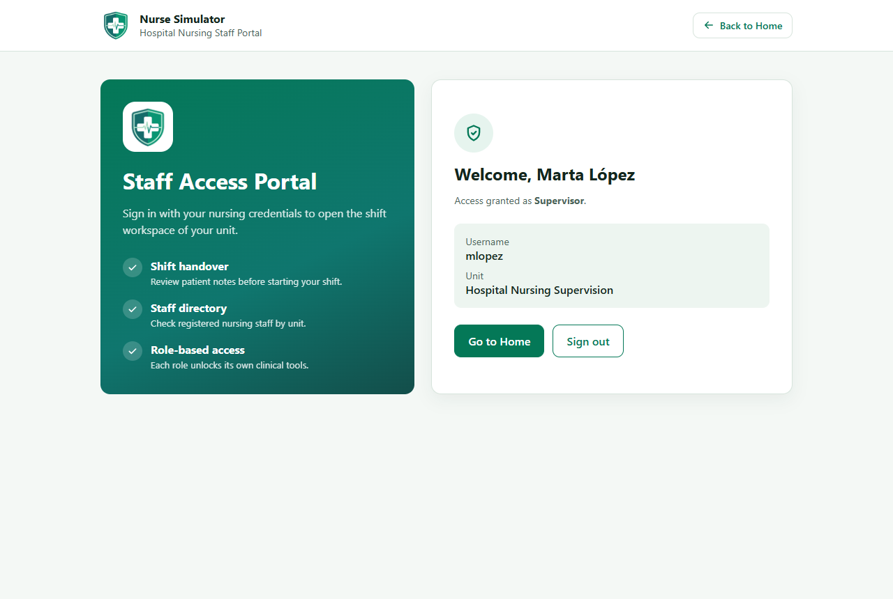 | 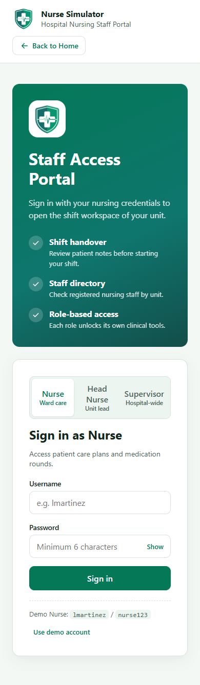 |

---

### 4.3. Nurse List (`/nurse-list`) — Directorio de Enfermeros Registrados

- **Componente:** `NurseList` ([`nurse-list.component.html`](src/app/components/nurse-list/nurse-list.component.html) | [`nurse-list.component.ts`](src/app/components/nurse-list/nurse-list.component.ts))
- **Funcionalidad:** muestra el catálogo de 10 enfermeros simulados (`MOCK_NURSES`), contadores en tiempo real (`10 of 10 Staff`, `7 On Duty`), filtros por turno (`All`, `Morning`, `Afternoon`, `Night`) y botón `Cycle Filter`. Al hacer clic en cualquier tarjeta (`selectNurse()`), actualiza el panel superior de inspección con correo, teléfono, planta y experiencia; el botón `×` (`clearSelection()`) muestra un placeholder `@else`.
- **Directivas:** `@if` / `@else` (detalle vs placeholder y cuadrícula vs estado vacío), `@switch` (descripción del filtro y estado del enfermero) y `@for` (pestañas y tarjetas).

| Vista general (`All` + detalle `Ana`) | Filtro por turno (`Night Shift Nurses`) | Selección de enfermero (`Lucia`) | Diseño Responsive (Móvil) |
| :---: | :---: | :---: | :---: |
| 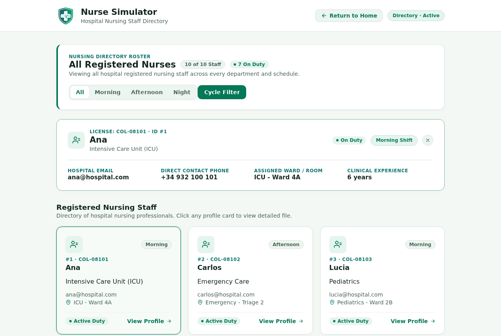 | 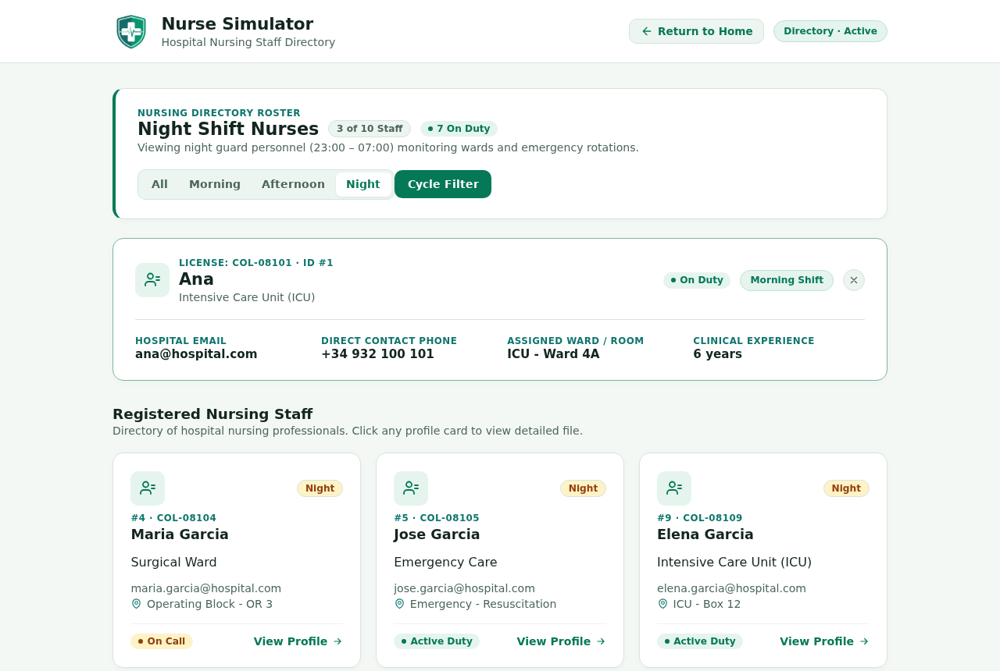 | 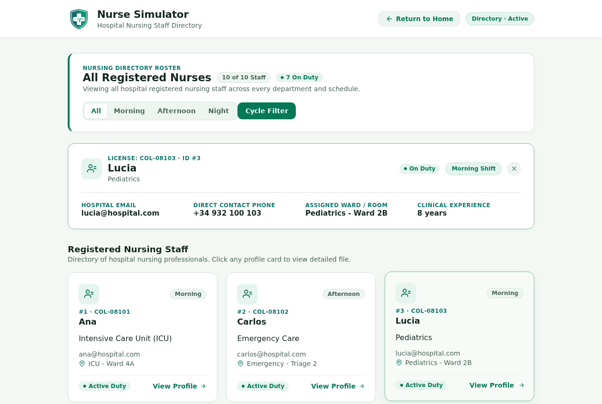 | 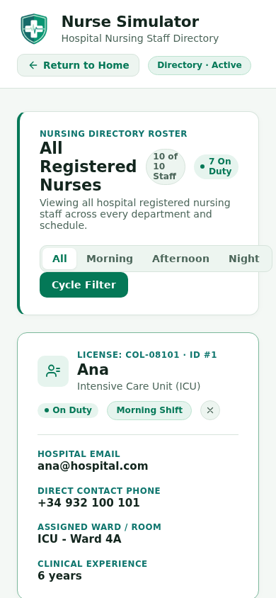 |

---

### 4.4. Nurse Search (`/nurse-search`) — Búsqueda por Nombre

- **Componente:** `NurseSearch` ([`nurse-search.component.html`](src/app/components/nurse-search/nurse-search.component.html) | [`nurse-search.component.ts`](src/app/components/nurse-search/nurse-search.component.ts))
- **Funcionalidad:** buscador reactivo por nombre sobre `MOCK_NURSES` con consulta inicial por defecto `'An'` que devuelve **3 resultados simulados** (`Ana`, `Antonio Garcia`, `Manuel Garcia`), chips de búsqueda rápida (`An`, `Garcia`, `Lucia`, `Pablo`), botón `Clear`, estado sin resultados con botón de recuperación (`Show sample results`) y detalles desplegables al pulsar cualquier tarjeta (`selectNurse()`).
- **Directivas:** `@if` / `@else if` / `@else` (resumen, estado vacío, sin resultados, lista y detalles expandibles), `@switch (nurse.status)` y `@for` (chips y resultados numerados).

| Consulta por defecto (`"An"` -> 3 resultados) | Detalle desplegado (`Antonio Garcia`) | Sin resultados (`"Pablo"`) | Diseño Responsive (Móvil) |
| :---: | :---: | :---: | :---: |
| 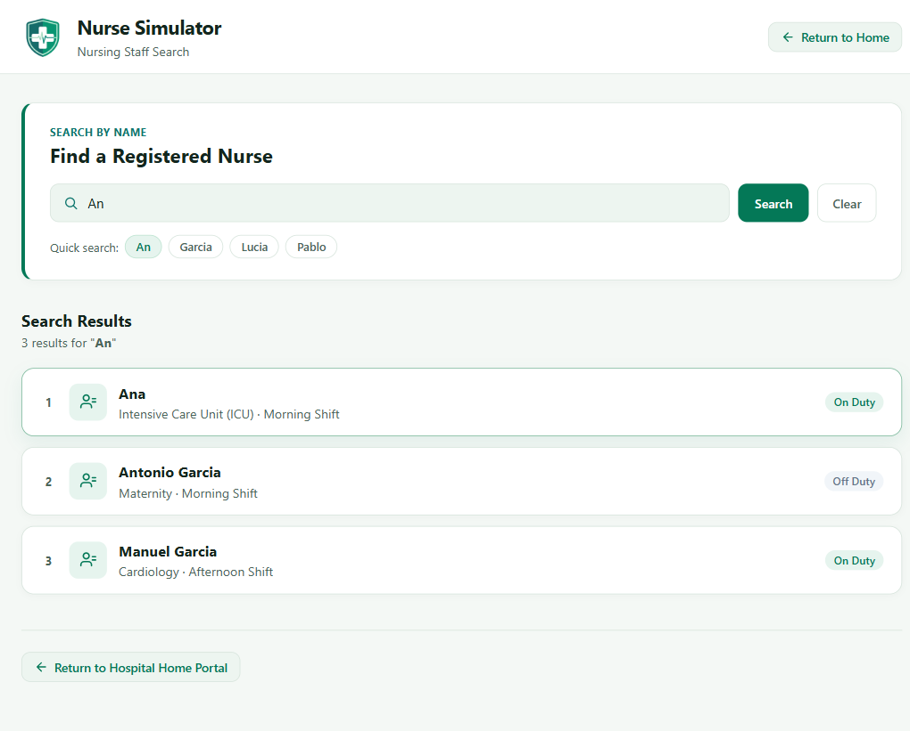 | 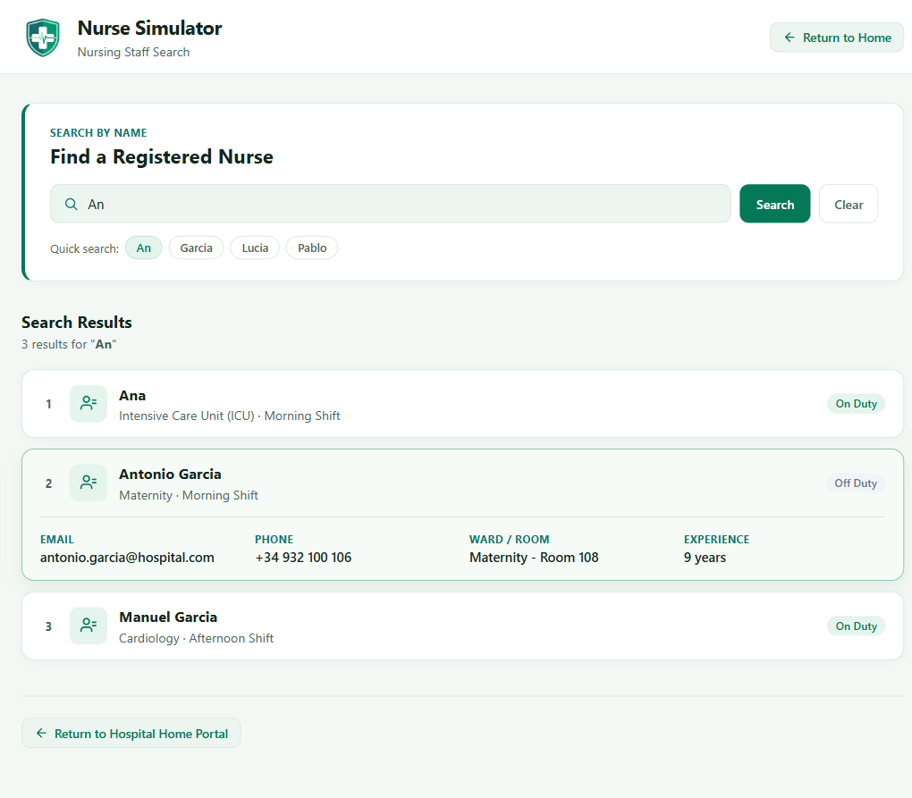 | 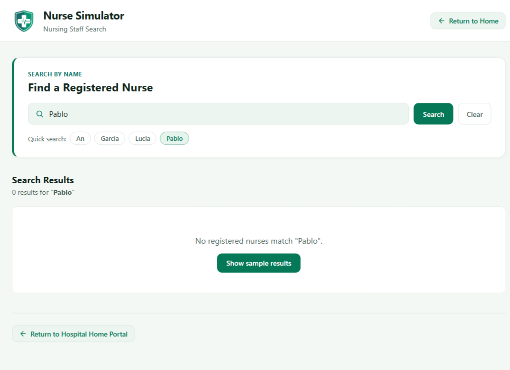 | 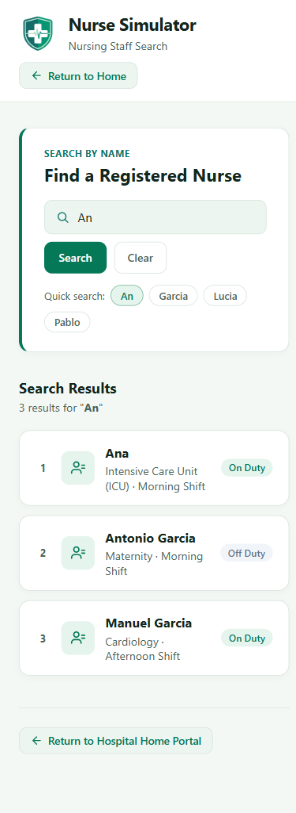 |

---

## 5. Arquitectura y Flujo de Navegación

### 5.1. Mapa de Rutas SPA (`src/app/app.routes.ts`)

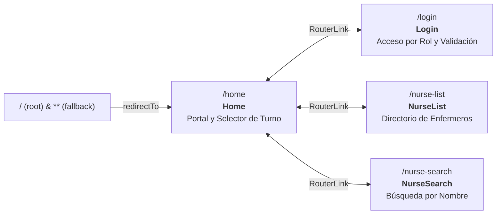

### 5.2. Arquitectura de Componentes y Datos Simulados

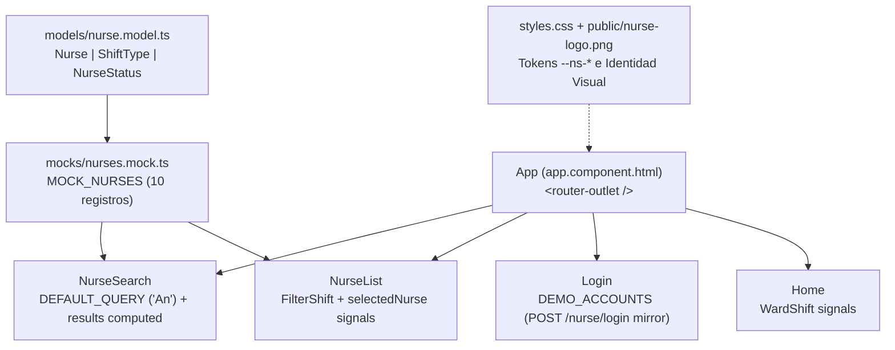

---

## 6. Flujo de Trabajo en GitHub

El repositorio sigue un flujo controlado coordinado mediante **[Nurse Simulator´s Project (#8)](https://github.com/users/Ignaciobrenas/projects/8)** y las reglas de [`AGENTS.md`](AGENTS.md):

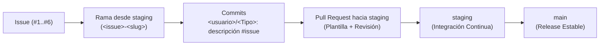

* **Prefijos oficiales de commit:** `ibrenas` | `rtito` | `gramirez` | `zyin-08`
* **Ejemplo válido:** `ibrenas/Docs: redesign README matching Nurse-Simulator style #6`
* **Verificación obligatoria antes de PR:** `npm run build` y `npm test` sin errores.

---

## 7. Stack Tecnológico, Instalación y Pruebas

### Stack Principal

| Tecnología | Versión | Uso en el Proyecto |
| :--- | :--- | :--- |
| **Angular** | `^22.2.0` | Componentes standalone, `@if` / `@switch` / `@for`, Signals y `@angular/router`. |
| **TypeScript** | `~6.0.2` | Tipado estricto (`tsconfig.json`) de componentes, modelos y mocks. |
| **RxJS** | `~7.8.0` | Utilidades reactivas base del ecosistema Angular. |
| **Vitest + jsdom** | `^5.0.0` / `^30.0.0` | Suite de pruebas unitarias de los 5 archivos `.spec.ts` (`28/28` tests). |
| **Prettier** | `^3.8.1` | Formateo consistente para TypeScript y plantillas Angular (`.prettierrc`). |

### Instalación y Ejecución Local

```bash
# 1. Clonar el repositorio
git clone https://github.com/Ignaciobrenas/Nurse-Simulator-Frontend.git
cd Nurse-Simulator-Frontend

# 2. Instalar dependencias
npm install

# 3. Iniciar el servidor de desarrollo local (http://localhost:4200/)
npm start
# o alternativamente:
npm run dev

# 4. Compilar la aplicación para producción
npm run build

# 5. Ejecutar la suite completa de tests unitarios (Vitest)
npm test -- --watch=false
```

---

## 8. Estructura del Proyecto

```text
Nurse-Simulator-Frontend/
├── .github/
│   └── pull_request_template.md        # Plantilla oficial de Pull Request
├── docs/
│   ├── general/
│   │   ├── DOCUMENTACION_ES.md         # Memoria técnica completa en español
│   │   └── DOCUMENTATION_EN.md         # Complete technical documentation in English
│   ├── screens/                        # Evidencias gráficas unificadas por pantalla
│   │   ├── home/                       # Capturas de Home (3 PNGs)
│   │   ├── login/                      # Capturas de Login (8 PNGs)
│   │   ├── nurse-list/                 # Capturas de Nurse List (13 PNGs)
│   │   └── nurse-search/               # Capturas de Nurse Search (6 PNGs)
│   └── tutorials/                      # Evidencias de ejercicios angular.dev
├── public/
│   ├── favicon.ico
│   └── nurse-logo.png                  # Logotipo oficial de Nurse Simulator
├── src/
│   ├── app/
│   │   ├── components/
│   │   │   ├── home/                   # Pantalla Home (#2)
│   │   │   ├── login/                  # Pantalla Login (#3)
│   │   │   ├── nurse-list/             # Pantalla Nurse List (#4)
│   │   │   └── nurse-search/           # Pantalla Nurse Search (#5)
│   │   ├── mocks/
│   │   │   └── nurses.mock.ts          # Dataset simulado MOCK_NURSES
│   │   ├── models/
│   │   │   └── nurse.model.ts          # Tipos Nurse, ShiftType y NurseStatus
│   │   ├── app.component.css
│   │   ├── app.component.html          # Shell raíz con <router-outlet />
│   │   ├── app.component.spec.ts
│   │   ├── app.component.ts
│   │   ├── app.config.ts               # Configuración con provideRouter(routes)
│   │   └── app.routes.ts               # Definición de rutas de la aplicación
│   ├── index.html                      # HTML raíz con título y favicon nurse-logo.png
│   ├── main.ts
│   └── styles.css                      # Tokens globales --ns-* (paleta clínica)
├── AGENTS.md                           # Normas compartidas del ecosistema Nurse Simulator
├── angular.json
├── package.json
└── README.md
```

---

<div align="center">
  <sub>Desarrollado por el equipo DAW 2 (Ignacio Breñas, Christopher Roger Tito, Gorka Ramirez, Zehao Yin) • STUCOM Pelai (Barcelona) • Curso 2026/27</sub>
</div>
